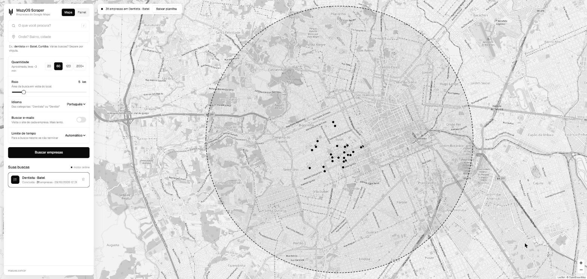

# MazyOS Scraper

Toda prospecção começa com uma lista. E montar essa lista na mão, copiando clínica por clínica do Google Maps pra uma planilha, come uma tarde inteira.

O MazyOS Scraper faz isso em segundos. Você digita o nicho e o bairro, ele busca no Google Maps e devolve as empresas num mapa e numa planilha, já separando quem tem WhatsApp, quem não tem site e quem só tem Instagram.

No meu primeiro teste, "dentista" no Batel, em Curitiba, voltaram 31 clínicas em uns 20 segundos. Oito delas sem site.




---

## Como instalar

### Pelo Claude Code (o jeito mais fácil)

Abra o Claude Code numa pasta qualquer e cole isto:

```
Clona o repositório https://github.com/mazzeoia/mazyos-scraper, entra na pasta e segue o CLAUDE.md pra instalar e abrir o MazyOS Scraper.
```

Ele baixa o código, instala o que faltar e abre a ferramenta no navegador. Funciona no Windows, no Mac e no Linux. Quando ele pedir permissão pra rodar o script de instalação, pode aprovar.

### Na mão (Windows)

1. Na lateral desta página, clique em **Releases** e baixe o arquivo `mazyos-scraper-windows.zip`.
2. Extraia o zip numa pasta qualquer (Documentos, por exemplo).
3. Dê dois cliques em **`Abrir MazyOS Scraper.cmd`**. O navegador abre sozinho em `http://localhost:8080`.

Na primeira vez ele baixa um navegador próprio (uns 150 MB), então a primeira busca demora um pouco mais.

O Windows pode mostrar o aviso "O Windows protegeu o computador". Isso acontece porque o programa não tem assinatura digital paga, não porque tem algo errado. Clique em **Mais informações** e depois em **Executar assim mesmo**.

Pra desligar, feche a janela "MazyOS Scraper" que fica minimizada na barra de tarefas.

Mac e Linux: use o caminho do Claude Code, ou rode `bash instalar.sh` e depois `bash abrir.sh` na pasta do projeto.

---

## Como usar

1. **O que você procura?** O nicho: "dentista", "pet shop", "escritório de advocacia". Pra buscar vários de uma vez, separe por vírgula.
2. **Onde?** Bairro e cidade. O mapa vai até o local e desenha o raio da busca.
3. **Quantidade:** 20, 60, 120 ou 200+. Quanto mais, mais demora (de 1 a 15 minutos).
4. **Buscar e-mails:** entra no site de cada empresa atrás de um e-mail. Deixa a busca bem mais lenta, então só ligue quando precisar.
5. Clique em **Buscar empresas**. Os pontos vão aparecendo no mapa enquanto ele trabalha.

Clicando num ponto, aparece a ficha da empresa: nota, número de avaliações, telefone (com link direto pro WhatsApp quando é celular), site e link pro Google Maps.

Na aba **Painel** ficam os números da busca, os filtros (Sem site, Só rede social, WhatsApp, Com e-mail) e dois botões. **Baixar planilha** gera um arquivo que abre direto no Excel, em português, só com o que estiver filtrado. **Copiar telefones** joga a lista de telefones na área de transferência.

O filtro mais útil pra quem vende site, tráfego ou automação? **Sem site.** É a empresa com avaliação boa no Google e nenhum lugar pra mandar o cliente.

---

## Como funciona por dentro

Ele não usa a API oficial do Google Maps. Por isso não precisa de chave, de cartão de crédito nem paga por consulta.

Funciona como um estagiário muito rápido. O programa abre o Google Maps num navegador invisível, pesquisa "dentista em Batel, Curitiba", rola a lista de resultados até o fim, entra na ficha de cada empresa e anota o que está na tela: nome, telefone, site, nota, endereço, horário. Depois junta tudo numa planilha.

A analogia quebra num ponto: o estagiário entende o que lê, o programa não. Ele depende da página do Google estar organizada do jeito que ele conhece. Quando o Google muda o layout do Maps, o programa pode parar de achar as informações até alguém atualizar o código.

---

## Limites e cuidados

- **Termos do Google.** Coletar dados do Maps de forma automática vai contra os termos de uso do Google. Na prática, o risco é o Google desconfiar do volume e mostrar captcha ou bloquear por um tempo. Use com moderação: algumas buscas por dia, não centenas.
- **A quantidade é aproximada.** Quem decide quantos resultados aparecem é o Google. Às vezes você pede 60 e vêm 45.
- **Pontos cinza no mapa** são empresas que o Google devolveu um pouco fora do raio escolhido.
- **LGPD.** Telefone de empresa listado no Google é dado público, mas a abordagem continua sujeita à LGPD. Se apresente, diga onde achou o contato e tire da lista na hora quem pedir pra não receber mais mensagem.

---

## Créditos

O motor é o [google-maps-scraper](https://github.com/gosom/google-maps-scraper), do Georgios Komninos (gosom), projeto de código aberto com licença MIT. O README original dele está em [README-original.md](README-original.md).

O que eu mudei nesta versão:

- **Interface nova**, em português, com mapa ao vivo, painel de leads, filtros e planilha no padrão do Excel brasileiro.
- **Correção pro Windows.** A versão oficial para de funcionar no Windows (as buscas voltam vazias, [issue #322](https://github.com/gosom/google-maps-scraper/issues/322)). O ajuste está em `third_party/scrapemate`.
- **Rota nova na API**, `GET /api/v1/jobs/{id}/places`, que devolve as empresas de uma busca em JSON.
- **Estatística de uso desligada.** O projeto original manda estatísticas anônimas de uso pro autor. O atalho `Abrir MazyOS Scraper.cmd` desliga isso (`DISABLE_TELEMETRY=1`).

---

## Pra quem programa

Precisa do [Go 1.27](https://go.dev/dl/). Na pasta do projeto:

```bash
go build -o mazyos-scraper .
./mazyos-scraper -web -addr :8080 -data-folder webdata
```

No Windows, gere `mazyos-scraper.exe` e use o `Abrir MazyOS Scraper.cmd`. Os arquivos da interface ficam em `web/static/` (`templates/index.html`, `css/mazyos.css`, `js/mazyos.js`). Todas as opções de linha de comando estão no [README original](README-original.md).
